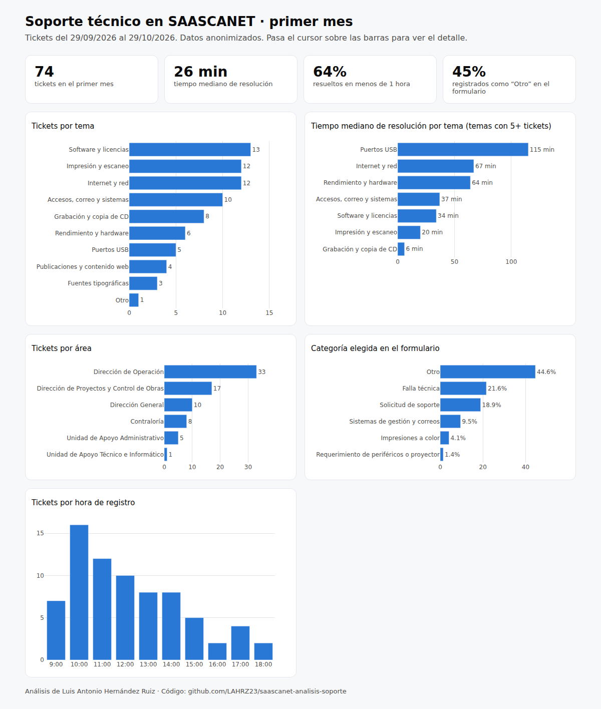
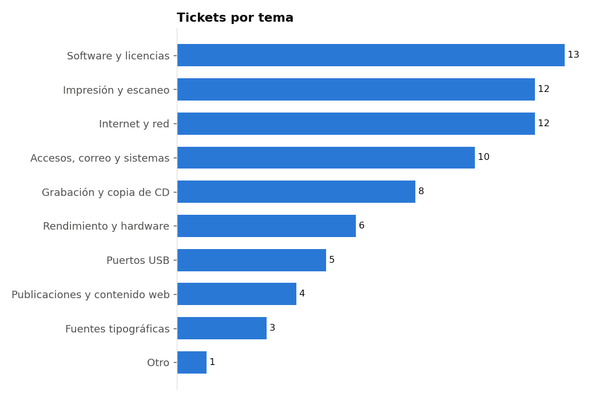
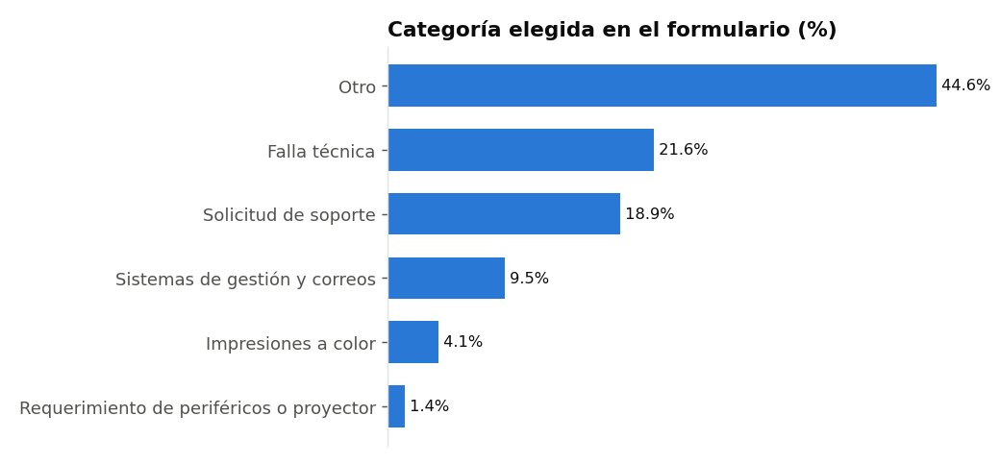

# Análisis del primer mes de soporte técnico en SAASCANET

Análisis con **SQL y Python** de las solicitudes de soporte técnico registradas en **SAASCANET**, la intranet que desarrollé para el SAASCAEM, un organismo público del Estado de México con ~110 usuarios. Se analiza el primer mes de operación de la versión actualizada del sistema, con datos reales anonimizados.

📊 **[Ver el dashboard interactivo](https://lahrz23.github.io/saascanet/dashboard.html)** · 📓 [Notebook con el análisis](notebooks/analisis_soporte.ipynb) · 🗃️ [Consultas SQL](sql/consultas.sql)



## Resultados principales

| Indicador | Valor |
|---|---|
| Tickets en el primer mes | **74** (29 sep – 29 oct 2026) |
| Tiempo mediano de resolución | **26 minutos** |
| Resueltos en menos de 1 hora | **64%** |
| Resueltos el mismo día | **86%** |
| Registrados como "Otro" en el formulario | **45%** |

## Preguntas de negocio

1. ¿Qué áreas piden más soporte y por qué tipo de problemas?
2. ¿Qué tan rápido se resuelven las solicitudes?
3. ¿Las categorías del formulario describen bien los problemas reales?
4. ¿Hay problemas recurrentes que convenga atender de raíz?
5. ¿Cuándo se concentra la demanda?

## Datos

74 tickets exportados de la base MySQL de SAASCANET. Para publicarlos:

- **Eliminé** nombres, comentarios y notas técnicas, porque contenían datos personales y, en un caso, credenciales.
- **Reemplacé** a los usuarios y técnicos por seudónimos (`Usuario 01`, `Técnico A`). El mismo nombre escrito con o sin acentos recibe el mismo código.
- **Clasifiqué** cada ticket en un *tema* a partir de su texto libre, con reglas de palabras clave, antes de eliminar ese texto (`scripts/anonimizar.py`).
- **Normalicé** el campo *Equipo*, que tenía más de 25 formas de escribirse, en 4 categorías.

| Columna | Descripción |
|---|---|
| `folio` | Folio del ticket |
| `usuario` | Seudónimo de quien lo solicitó |
| `area` | Área de la dependencia |
| `equipo_tipo` | Laptop, PC de escritorio, periférico o sin especificar |
| `tipo_formulario` | Categoría que eligió el usuario al levantar el ticket |
| `tema` | Tema real del problema, clasificado a partir del texto |
| `estatus` | Resuelto o No procede |
| `registrado`, `resuelto` | Fecha y hora de registro y de resolución |
| `tecnico` | Seudónimo del técnico que lo atendió |
| `n_participantes` | Número de técnicos que participaron |

## Enfoque

1. **Calidad de datos primero:** encontré 2 tickets con la fecha de resolución anterior a la de registro (excluidos de los tiempos) y 4 folios faltantes en la secuencia.
2. **SQL para responder las preguntas:** agregaciones, `CASE`, una función de ventana (`ROW_NUMBER`) para obtener el tema principal por área y una CTE recursiva para detectar folios faltantes. El notebook carga el CSV en SQLite y ejecuta las mismas consultas.
3. **Mediana en lugar de promedio** para los tiempos: unos pocos tickets tardan días y llevan el promedio a ~5 horas, cuando la mitad se resuelve en menos de media hora.
4. **Dashboard en Python (Plotly)** para presentar los hallazgos a quien toma las decisiones.

## Hallazgos y recomendaciones

| Hallazgo | Recomendación |
|---|---|
| **45%** de los tickets se registra como "Otro" | Rediseñar las categorías del formulario con los temas reales |
| **5 tickets** de puertos USB del mismo usuario en 3 semanas | Escalar a reemplazo o mantenimiento mayor cuando un problema se repite 3 veces |
| **8 tickets** (11%) para copiar información entre CD y USB | Crear una guía o un equipo de autoservicio |
| **3 instalaciones** de la fuente institucional Gotham | Incluirla en la configuración estándar de los equipos |
| El **38%** de las solicitudes llega entre 10:00 y 12:00 | Tener al equipo completo en ese horario y programar el mantenimiento por la tarde |
| Campo *Equipo* en texto libre, fechas inconsistentes y folios faltantes | Lista desplegable o número de inventario, validar fechas al guardar y registrar eliminaciones en la bitácora |





## Limitaciones

- **Es un solo mes (74 tickets):** los patrones son iniciales y hay que confirmarlos con más meses de datos.
- El tema se clasificó con reglas de palabras clave, así que puede haber errores de clasificación.
- Los tiempos incluyen horas fuera de la jornada cuando un ticket se cierra al día siguiente.
- **No comparo el desempeño de los técnicos:** con 3 personas, el dato sería identificable aunque esté anonimizado.

## Estructura del repositorio

```
saascanet-analisis-soporte/
├── data/tickets_anonimizados.csv
├── sql/consultas.sql              # consultas SQL del análisis
├── notebooks/analisis_soporte.ipynb
├── dashboard/dashboard.html       # dashboard interactivo (funciona sin internet)
├── scripts/
│   ├── anonimizar.py              # anonimización y clasificación por tema
│   └── crear_dashboard.py         # genera el dashboard
├── images/
└── requirements.txt
```

## Cómo ejecutarlo

```bash
git clone https://github.com/LAHRZ23/saascanet-analisis-soporte.git
cd saascanet-analisis-soporte
pip install -r requirements.txt
jupyter notebook notebooks/analisis_soporte.ipynb
python scripts/crear_dashboard.py      # regenera el dashboard
```

## Tecnologías

SQL (SQLite / MySQL) · Python · pandas · Matplotlib · Plotly · Jupyter

## Autor

**Luis Antonio Hernández Ruiz**, Data Scientist / Data Analyst Jr
[Portafolio](https://lahrz23.github.io) · [LinkedIn](https://www.linkedin.com/in/luis-antonio-hern%C3%A1ndez-ruiz-1abb21185/) · [GitHub](https://github.com/LAHRZ23)

> Datos publicados con autorización de la Unidad de Apoyo Técnico e Informático del SAASCAEM.
